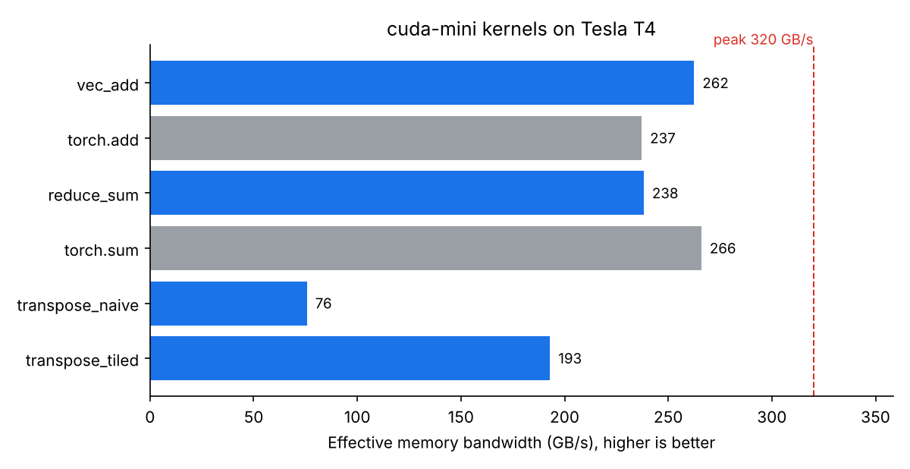

# cuda-mini

[](https://github.com/hasheramin/cuda-mini/actions/workflows/ci.yml)
[](LICENSE)
[](https://colab.research.google.com/github/hasheramin/cuda-mini/blob/main/notebooks/colab_demo.ipynb)

Small, readable CUDA kernels with a Python harness that builds them, checks them against PyTorch and benchmarks them. Each kernel comes in a naive and an optimized version, so you can see what the optimization buys.

| Kernel | Versions | Idea |
|---|---|---|
| vector add | `vec_add` | baseline, memory-bound |
| sum reduction | `reduce_sum` | grid-stride loop, warp shuffle, `atomicAdd` |
| transpose | `transpose_naive`, `transpose_tiled` | coalescing, shared memory, bank-conflict padding |
| softmax | `softmax_naive`, `softmax_warp` | one thread per row vs one warp per row |
| matmul | `matmul_naive`, `matmul_tiled` | data reuse through shared memory, compared with cuBLAS |

## Quick start

**No GPU?** Click the **Open In Colab** badge above, choose **Runtime > Run all**, and everything runs on a free GPU.

**With an NVIDIA GPU and the CUDA toolkit:**

```bash
pip install -r requirements.txt   # needs a CUDA build of PyTorch
python bench.py                   # build, verify and benchmark everything
python bench.py --kernel matmul   # one group: vec_add, reduce, transpose, softmax, matmul
python bench.py --save            # also write results/<gpu-name>.json
python -m pytest -q tests         # correctness tests with odd sizes
```

`make bench`, `make test` and `make readme` do the same if you prefer `make`.

## Results

<!-- RESULTS:START -->

#### Tesla T4 (compute capability 7.5)



| Kernel | Time (ms) | Bandwidth (GB/s) | % of peak | GFLOP/s |
|---|---:|---:|---:|---:|
| `vec_add` | 3.068 | 262.5 | 82% | - |
| `torch.add` | 3.395 | 237.2 | 74% | - |
| `reduce_sum` | 1.127 | 238.2 | 74% | - |
| `torch.sum` | 1.009 | 266.0 | 83% | - |
| `transpose_naive` | 7.090 | 75.7 | 24% | - |
| `transpose_tiled` | 2.781 | 193.0 | 60% | - |

Peak memory bandwidth: 320 GB/s.

<!-- RESULTS:END -->

Numbers vary slightly between runs and GPUs. Bandwidth is the ideal bytes read plus written divided by the kernel time; matmul is reported in GFLOP/s (2 x M x N x K operations).
Results come from `results/*.json`, and `python tools/update_readme.py` rebuilds the tables above.

### What to notice

- **Memory-bound kernels:** vector add and sum reduction do almost no math, so their speed is set by memory bandwidth, and the "% of peak" column shows how close they get to the GPU's limit.
- **Naive vs tiled transpose:** staging a tile in shared memory makes both the global reads and the global writes coalesced, and the `+1` padding avoids shared-memory bank conflicts.
- **Softmax and matmul:** `softmax_warp` lets a whole warp read each row together instead of one thread per row, and `matmul_tiled` reuses every loaded value 32 times from shared memory. See [docs/how-it-works.md](docs/how-it-works.md) for the reasoning behind each kernel.

## Project layout

```
cuda-mini/
├── kernels/
│   ├── basic.cu          # vec_add, reduce_sum, transpose (naive + tiled)
│   ├── softmax.cu        # softmax (naive + warp per row)
│   └── matmul.cu         # matmul (naive + tiled)
├── bench.py              # build, verify against PyTorch, benchmark, save JSON
├── tests/test_kernels.py # correctness tests with odd sizes
├── tools/
│   ├── plot.py           # results/*.json -> docs/bandwidth_<gpu>.png
│   └── update_readme.py  # results/*.json -> results table in this README
├── results/              # one JSON file per GPU
├── notebooks/colab_demo.ipynb
├── docs/how-it-works.md
├── Makefile
└── .github/workflows/ci.yml
```

## Adding a kernel

See [CONTRIBUTING.md](CONTRIBUTING.md). In short: write the kernel and an `extern "C"` launcher in `kernels/`, add a `bench_<name>` function to `bench.py` and a test to `tests/`.
Results from other GPUs are welcome: run `python bench.py --save` and open a pull request with the new `results/<gpu-name>.json`.

## License

[MIT](LICENSE)
